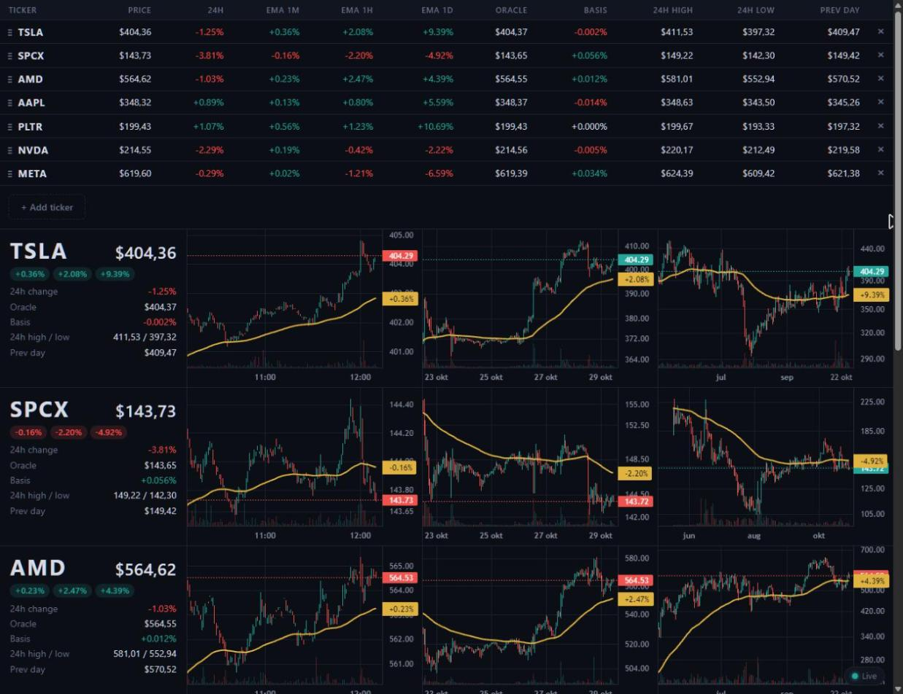

# Deltaspect

A live market dashboard for the stock perpetuals traded on Hyperliquid's `xyz` market
(TSLA, AMD, AAPL, SpaceX and more). It runs entirely in the browser: no backend, no API key.

**Live: [deltaspect.com](https://deltaspect.com)**



## Features

- **Overview table**: every ticker's price, 24h change, distance from its moving average on each
  timeframe, oracle price, basis and 24h range. Click a header to sort, a ticker to jump to its charts.
- **Your own watchlist**: add, remove and drag to reorder tickers in the table. The list is saved
  in your browser.
- **Live charts**: 1-minute, 1-hour and 1-day candles per ticker, with volume and a gold moving
  average (an EMA with a 31-bar half-life, equivalent to a 90-period EMA). The gold label on each
  chart's price axis shows how far the price is above or below it.
- **Phone friendly**: on narrow screens each ticker shows one chart, picked with 1 min / 1 hour / 1 day tabs.

## How it works

History comes from Hyperliquid's public REST API and live updates from a single shared WebSocket,
both called straight from the browser. Every push to `main` builds the site and deploys it to
GitHub Pages.

## Run locally

```sh
npm install
npm run dev      # http://localhost:5173
npm run build    # static site in dist/
```

The default ticker list and how much history each chart loads are set in `src/config.ts`.
